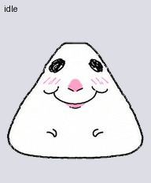

# Hamblob

bro is built like a sentient tortilla chip 😭 pink nose, zero thoughts, catastrophic levels of whimsy. no long legs. just a triangular unc who squishes across your screen like he pays rent here.

## the lore goes crazy

yes it's the “stupid ass hamster” 😭 actual lore name: **Almarts27 Hamster / Hamster Drawing Memes**. [art by alma (@almarts27)](https://www.instagram.com/almarts27/) cooked the original character. according to [Know Your Meme](https://knowyourmeme.com/memes/hamster-drawing-memes-almarts27-hamster), the first drawings dropped December 7, 2023. then bro escaped containment and became reaction images and TikTok stickers.

this AI-generated remix is **Hamblob**. bottom-middle face is his default aura. open-mouth joy, vacant stare, tongue-out crashout — bro has the emotional range of an entire group chat. the triangular blob does the moving. the brain cell remains unconfirmed.

## Setup

1. Download [spritesheet.png](spritesheet.png), or clone this repository.
2. In a compatible Codex/ChatGPT client with the **Pets** plugin enabled, attach the PNG and ask:

   > Import this finished v2 sprite sheet as a custom pet named Hamblob. Preserve its existing artwork and animations, validate it, then create and select the pet.

The client needs pet creation/import support. No code, Python install, or image regeneration is needed to use the finished sheet. A pet share/adopt link is another option when available; this repository does not include one.

## Files

- `spritesheet.png`: transparent 1536 × 2288 PNG; 8 × 11 cells of 192 × 208; 73 frames, nine animation states and sixteen look directions.
- `pet.json`: portable name, description, and sprite layout.
- `previews/`: individual state GIFs, full animation GIF/MP4, jump transition, look loop, and contact sheets.
- `reference/`: supplied expression sheet and generated canonical design.

Some near-vertical look poses have subtle sideways cues. The final sheet passed structural and motion quality checks.

Original meme art is credited above; this fan adaptation is not affiliated with its creator.
